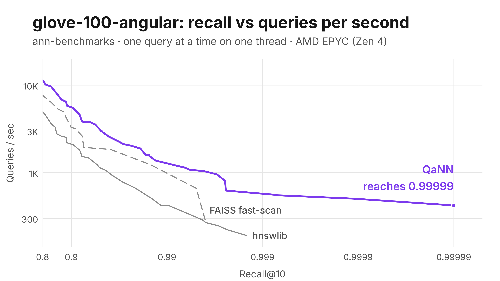

# QaNN

QaNN (**Q**uantized **N**earest **N**eighbors) is a Python library for fast nearest-neighbor search, written in multithreaded, SIMD-accelerated C++ and driven from NumPy and SciPy.

- **Dense vectors:** exact search, IVF and HNSW graph search, product and scalar quantization, exact re-ranking.
- **Sparse vectors** (BM25, SPLADE): exact and approximate inverted-index search.
- **Every index:** custom ids, deletion, metadata filters, saving and loading.

> **Alpha:** under active development. The API may change between releases.

## Performance



GloVe-100 (1.2M word vectors, angular) on [ann-benchmarks](https://github.com/erikbern/ann-benchmarks): recall@10 against queries per second, one query at a time on one thread of an AMD EPYC 9J14 (Zen 4) VM; up and to the right is better. qann 0.1.0a27, hnswlib 0.8.0, faiss-cpu 1.14.3. Each line is that library's fastest index on this dataset: qann's IVF fast-scan with re-ranking (`qann-ivf-fastscan`), hnswlib's HNSW and FAISS's IVF-PQ fast-scan. qann's own HNSW, left out for readability, ran just ahead of hnswlib. The harness and configs are on the [`external-benchmarks`](https://github.com/maxtmiller/qann/tree/external-benchmarks/benchmarks/external) branch.

## Install

```bash
pip install qann
pip install scipy   # only for the sparse indexes
```

- Wheels: Linux (x86_64, aarch64) and macOS (Apple Silicon, Intel), Python 3.10 to 3.14. x86_64 needs AVX2 and FMA.
- From source: `pip install .` in a checkout. Needs CMake 3.20+, a C++20 compiler and, on Linux, optionally OpenBLAS (much faster training).

## Quick start

```python
import numpy as np, qann

x = np.random.rand(100_000, 128).astype(np.float32)

ivf = qann.IVFIndex(128, nlist=1024, nprobe=16)
ivf.enable_pq(16)                           # store each vector in 16 bytes
ivf.train(x, seed=1)
index = qann.RefineIndex(ivf, k_factor=10)  # re-rank PQ candidates exactly
index.add(x)

ids, dists = index.batch_query(x[:5], 10)   # both shaped (5, 10)
```

## Conventions

- **Vectors** are 2D NumPy arrays of shape `(n, dim)`; single vectors (`query`) are `(dim,)`. float32 C-contiguous arrays are used without copying; anything else is converted first.
- **Ids** count up from 0 in insertion order, unless the index uses [custom ids](#custom-ids-and-deleting).
- **Distances** are smallest first: squared L2 by default, or cosine distance / negative inner product with another [metric](#metrics).
- **Results** from `batch_query` are an `int64` id array and a `float32` distance array, both `(num_queries, k)`. Missing hits are padded with id `-1` and distance `inf`.

## Indexes

Indexes come in two families, with one class per search algorithm:

| | Dense vectors (`qann.DenseIndex`) | Sparse vectors (`qann.SparseIndex`) |
| --- | --- | --- |
| Exact | `FlatIndex` | `InvertedIndex` |
| Approximate | `IVFIndex`, `HNSWIndex`, `RefineIndex` (exact re-ranking of either) | `SparseApproxIndex` |

- The algorithm is fixed when an index is created. Search settings such as `nprobe` or `ef_search` are properties you can change at any time. To switch type, rebuild: `new.add(old.get_vectors(old.ids()), ids=old.ids())` (ids only if `new` uses custom ids).
- Ids, deletion, metadata, filters and saving work the same in both families (`qann.IndexBase`).
- `qann.Index` is the old name of `qann.DenseIndex` and still works.
- `HybridIndex` combines a dense and a sparse index over the same documents; see [Hybrid search](#hybrid-search).

Methods every dense index has (sparse indexes take `scipy.sparse` matrices instead and have no `dim`):

| Method | Description |
| --- | --- |
| `add(data, ids=None, *, metadata=None)` | Add an `(n, dim)` array, plus ids if the index uses custom ids and optional [metadata](#metadata). Returns the ids. |
| `batch_query(queries, k, *, allowed=None, where=None)` | k nearest neighbors per row, in parallel. Returns `(ids, dists)`. See [Filtered search](#filtered-search) for `allowed` and `where`. |
| `query(query, k, *, allowed=None, where=None)` | k nearest neighbors of one `(dim,)` vector. Returns 1D `(ids, dists)`. |
| `remove(ids)` | Delete vectors by id. Returns how many were deleted. |
| `compact()` | Free the memory of deleted vectors. Returns how many were freed. |
| `size()`, `dim()` | Number of (non-deleted) vectors; vector dimension. |
| `ids(*, where=None)` | Every live id, ascending (sparse indexes too); with `where`, only those whose [metadata](#metadata) matches, with no vector search. |
| `get_vectors(ids)` | Copies of the stored vectors, `(n, dim)`, in the order given. Not on PQ or SQ indexes, which keep only codes (`stores_vectors` is `False`); a `RefineIndex` over them works. With `Cosine` they come back unit-length. |
| `save(path)` | Save to a file; see [Saving and loading](#saving-and-loading). |
| `metadata_schema`, `get_metadata`, `update_metadata`, `add_metadata_column`, `drop_metadata_column` | See [Metadata](#metadata). |

Which to pick: `FlatIndex` up to a few hundred thousand vectors; IVF + fast-scan + `RefineIndex` when you can train on representative data and build time matters; HNSW when you can't train up front or new kinds of vectors keep arriving. Benchmark on your own data; [measurements](https://github.com/maxtmiller/qann/blob/main/ARCHITECTURE.md#choosing-an-index).

### `FlatIndex(dim, *, custom_ids=False)`

Exact brute-force search: no training, 100% recall, cost linear in the number of vectors. Also useful as ground truth when measuring recall.

```python
index = qann.FlatIndex(128)
index.add(x)
ids, dists = index.batch_query(x[:10], 10)
```

### `IVFIndex(dim, nlist, nprobe=10, *, custom_ids=False)`

Clusters vectors into `nlist` lists with k-means, and scans only the `nprobe` lists nearest each query.

| Member | Description |
| --- | --- |
| `train(data, max_iters=25, seed=None)` | Learn the centroids from at least `nlist` vectors. Call once, before `add`. |
| `enable_pq(num_subspaces, centroids_per_subspace=None, *, fast_scan=False, rotate=False)` | Compress vectors with [product quantization](#product-quantization). Call before `train`. |
| `enable_sq(bits=8)` | Store 8 or 4 bits per dimension instead of floats ([SQ](#sq)). Call before `train`; not with PQ. |
| `nprobe` | Lists scanned per query: higher is slower and more accurate. |
| `pq_distance` | `qann.PQDistance.ADC` (default, more accurate) or `SDC`. |
| `precomputed_tables` | Lookup tables built at train time that speed up PQ queries. On by default; `False` frees them. |
| `fast_scan`, `sq_bits` | Read-only: the compression in use. |

- `nlist` must be 100 to 65535. Start with `nlist` around `sqrt(n)` to `4 * sqrt(n)`, and `nprobe` at 1% to 5% of `nlist`.
- **With PQ**, each vector is split into `num_subspaces` slices stored as one byte each: a 128-dim vector (512 bytes) with 16 subspaces takes 16 bytes. `dim` must divide evenly. Distances become approximate; wrap the index in a `RefineIndex` to recover recall.

```python
ivf = qann.IVFIndex(128, nlist=1024, nprobe=16)
ivf.enable_pq(16)
ivf.train(x, seed=1)
ivf.add(x)
ivf.nprobe = 32   # trade speed for recall
```

#### Fast-scan

`enable_pq(num_subspaces, fast_scan=True)` stores 4 bits per slice and scores 32 vectors per SIMD lookup, about 6x faster than regular PQ. Use twice the subspaces you would with regular PQ, and pair it with a `RefineIndex`:

```python
ivf = qann.IVFIndex(128, nlist=1024, nprobe=16)
ivf.enable_pq(64, fast_scan=True)          # 64 x 4 bits = 32 bytes per vector
ivf.train(x, seed=1)
refine = qann.RefineIndex(ivf, k_factor=16)
refine.add(x)
```

- `num_subspaces` must be even and at most 1024. `pq_distance` must stay `ADC`.
- Without a `RefineIndex`, recall is lower and distances are approximate.

#### Rotation

`enable_pq(..., rotate=True)` also learns a rotation that spreads information evenly over the subspaces. It helps when dimensions are correlated (SIFT: noticeably higher recall before re-ranking) and does nothing when they aren't (GloVe). Results stay valid either way. Measure on your data.

#### SQ

`enable_sq(8)` stores one byte per dimension (a quarter of the floats' memory) and `enable_sq(4)` half a byte. 8 bits loses little recall and needs no `RefineIndex`; 4 bits should be wrapped in `RefineIndex(k_factor=8)`.

```python
ivf = qann.IVFIndex(128, nlist=1024, nprobe=16)
ivf.enable_sq(8)
ivf.train(x, seed=1)
ivf.add(x)
```

[Fast-scan, rotation and SQ measurements](https://github.com/maxtmiller/qann/blob/main/ARCHITECTURE.md#ivf-fast-scan-rotation-and-sq).

### `HNSWIndex(dim, M=16, ef_construction=200, *, custom_ids=False, seed=None)`

A graph index: each vector links to `M` near neighbors, and a query walks the graph toward its target. No training, exact distances, builds on all cores; it uses more memory per vector and adds more slowly than IVF.

| Member | Description |
| --- | --- |
| `ef_search` | Candidates kept while searching (default 64): higher is slower and more accurate. |
| `M`, `ef_construction` | Read-only: the build settings. Higher builds a better graph, more slowly. |
| `enable_sq(bits=8)`, `train(x)` | Store 8- or 4-bit codes instead of floats. Call `enable_sq`, then `train` on a representative sample, before `add`. |
| `sq_bits` | Read-only: 8 or 4 with SQ, else 0. |

```python
index = qann.HNSWIndex(128, M=16, ef_construction=200)
index.add(x)
index.ef_search = 128   # trade speed for recall
ids, dists = index.batch_query(q, 10)
```

- **`M`:** 16 suits data like SIFT. For text embeddings use `M=32` to `48` with `ef_construction=300` to `400`.
- **Deleting** hides vectors from results. `compact()` rebuilds the graph, so call it after many deletes, not each one.
- **Reproducible builds** need `seed` and `qann.set_num_threads(1)`; parallel builds differ slightly run to run.
- **SQ:** wrap in a `RefineIndex`. `k_factor=2` is enough for 8 bits; 4 bits needs 4 to 8.

```python
index = qann.HNSWIndex(128)
index.enable_sq(8)
index.train(x)
refine = qann.RefineIndex(index, k_factor=2)
refine.add(x)
```

[HNSW measurements](https://github.com/maxtmiller/qann/blob/main/ARCHITECTURE.md#hnsw-m-deletes-and-sq).

### `RefineIndex(base, k_factor=10, *, custom_ids=False)`

Fetches `k * k_factor` candidates from an approximate `base`, then re-ranks them by exact distance using full copies of the vectors. This is the usual way to get PQ or SQ speed with near-exact ranking.

- `base` must be trained, empty, without custom ids and never compacted. Give the `RefineIndex` its own `custom_ids` instead.
- Add, remove and compact through the `RefineIndex`. Doing it on the base raises `ValueError`.
- Tune the base through the `base` property, e.g. `refine.base.nprobe = 32`. `k_factor` can change at any time.

### `InvertedIndex(*, custom_ids=False)`

Exact search over sparse vectors: BM25 weights or learned sparse vectors such as SPLADE, as `scipy.sparse` matrices (a column is a term id). Scores by dot product: distance is `-(q . d)`, largest dot product first.

```python
import scipy.sparse as sp

index = qann.InvertedIndex()
index.add(doc_matrix, metadata={"lang": langs})             # (n_docs, vocab) CSR
ids, dists = index.batch_query(query_matrix, 10, where="lang = 'en'")
ids, dists = index.query(query_matrix[[0]], 10)             # one row
```

- **Input:** any `scipy.sparse` matrix or array; term ids below 2^32. Duplicate entries in a row are summed, zeros dropped.
- **Results:** only documents sharing a term with the query come back, so a row can have fewer than `k`.
- **Pruning** (`pruning`, on by default) skips work that can't change the top `k`. Results are identical either way; it helps most at small `k`.
- **Size:** `terms` and `postings` count distinct terms and stored entries (8 bytes each).

### `SparseApproxIndex(*, custom_ids=False, query_terms=10, list_depth=10000, k_factor=10)`

Approximate sparse search for queries with many terms, such as SPLADE's. Same input and features as `InvertedIndex`, about twice its memory.

```python
index = qann.SparseApproxIndex()
index.add(doc_matrix)
ids, dists = index.batch_query(query_matrix, 10)
index.list_depth = 2000          # faster, lower recall
```

- A query uses its `query_terms` largest values, reads the `list_depth` heaviest entries of those terms, and re-scores the best `k * k_factor` exactly. `0` means all.
- Returned distances are exact; only which documents are found is approximate.
- The defaults reached 0.96 recall@10 at about 14x the speed of exact search on 1M SPLADE passages. [Measurements](https://github.com/maxtmiller/qann/blob/main/ARCHITECTURE.md#sparse-indexes).

### `BM25(k1=1.2, b=0.75)`

Turns texts into BM25 sparse vectors for `InvertedIndex` or `HybridIndex`, and stays exact as documents come and go:

```python
bm25 = qann.BM25()
index = qann.InvertedIndex(custom_ids=True)
index.add(bm25.encode_documents(texts), ids=doc_ids)
ids, dists = index.query(bm25.encode_query("rate limits on the api"), 10)

index.remove(old_ids)
bm25.remove(old_texts)                 # keep the counts in step with the index
```

- **Scores:** documents store saturated term frequencies and each query carries IDF from the current counts, so adds and removes keep scores the same as recomputing BM25 over the live documents, without re-encoding stored ones.
- **Tokens:** lowercase ASCII letters and digits, Lucene's English stopwords removed, no stemming. FiQA nDCG@10 0.238, matching BEIR's Lucene BM25.
- **No vocabulary:** a term's id is its 31-bit CRC-32 hash. The counts aren't saved with an index; after `qann.load`, call `bm25.rebuild(texts)` with the stored texts (about 5 s for 1M FiQA-sized documents on an M3).
- `encode_queries(texts)` encodes a batch; `num_documents`, `num_terms` and `total_length` show the counts.

### `make_index(type, dim, opts=IndexOptions())`

Builds any index from a type and an options object:

```python
opts = qann.IndexOptions()
opts.nlist, opts.nprobe, opts.pq_subspaces = 1024, 16, 16
ivf = qann.make_index(qann.IndexType.IVF, 128, opts)
```

`IndexType` is `Flat`, `IVF`, `HNSW`, `Inverted` or `SparseApprox` (sparse types ignore `dim`; pass 0). `IndexOptions` fields and defaults:

| For | Fields |
| --- | --- |
| all | `custom_ids` (False), `metric` (L2, dense only) |
| Flat | `capacity` (1024) |
| IVF | `nlist` (100), `nprobe` (10), `pq_subspaces` (0 = no PQ), `pq_centroids` (256), `ivf_sq_bits` (0) |
| HNSW | `hnsw_m` (16), `ef_construction` (200), `ef_search` (64), `hnsw_sq_bits` (0) |
| Inverted | `pruning` (True) |
| SparseApprox | `query_terms` (10), `list_depth` (10000), `k_factor` (10) |

## Metrics

Dense indexes take `metric=qann.Metric.L2` (default), `Cosine` or `InnerProduct`, fixed at construction, saved with the index and reported by `index.metric`. They work with every dense index and compression.

```python
index = qann.HNSWIndex(384, metric=qann.Metric.Cosine)
index.add(embeddings)
ids, dists = index.batch_query(query_embeddings, 10)   # dists = 1 - cosine similarity
```

- **Cosine** suits most text and image embeddings. Distance is `1 - cosine similarity` (0 to 2). Vectors are normalized for you; a zero vector raises `ValueError`.

### Inner product

Use `InnerProduct` when vector length matters: recommendation factors, multi-vector retrieval (ColBERT, MUVERA), models trained with a dot-product loss.

```python
index = qann.HNSWIndex(64, metric=qann.Metric.InnerProduct)
index.add(item_factors)
ids, dists = index.batch_query(user_factors, 10)   # dists = -(q . x)
```

- Distance is `-(q . x)`, so results stay smallest first. Nothing is normalized.
- PQ must use `ADC`, and `precomputed_tables` reads `False` (not needed).
- HNSW links its graph with a transform that makes inner product search work far better than linking by raw dot product. [Measurements](https://github.com/maxtmiller/qann/blob/main/ARCHITECTURE.md#inner-product).

## Custom ids and deleting

Create an index with `custom_ids=True` to use your own ids (database keys, document ids):

```python
index = qann.FlatIndex(128, custom_ids=True)
index.add(vectors, ids=doc_ids)               # one int per row
ids, dists = index.batch_query(queries, 10)   # ids are your doc_ids
index.remove([doc_ids[0], doc_ids[1]])        # returns 2
```

- **Ids** can be any integer array, list or `range`. They must be `>= 0` and unique; a bad batch adds nothing. Every add must pass them.
- **`remove`** skips unknown and already deleted ids. A deleted id can be added again.
- **`compact()`** frees deleted vectors' memory and keeps ids and results unchanged (HNSW rebuilds its graph, so its results can shift slightly). Call it after a large batch of deletes.
- **Default ids never repeat,** even after deletes and `compact()`. Keep the ids `add()` returns, or use custom ids for data that changes.

## Filtered search

To search only some vectors, pass the ids that may be returned as `allowed`, or filter on stored [metadata](#metadata) with `where`:

```python
in_stock = product_ids[stock > 0]
ids, dists = index.batch_query(queries, 10, allowed=in_stock)
```

- **Filtering happens during the search,** so a selective filter still returns `k` results when that many match.
- **Works on every index,** with recall close to unfiltered search. Very narrow filters switch to scoring the allowed vectors directly, which is exact.
- **Unknown and deleted ids in `allowed` are ignored.** One set applies to every row of a `batch_query`.
- **Tuning:** `HNSWIndex.filter_ef_scaling` and `IVFIndex.filter_probe_scaling` (both on, not saved) keep filtered recall near unfiltered. Turn them off for faster queries when filtered recall is already high on your data.

[How each index filters, and measurements](https://github.com/maxtmiller/qann/blob/main/ARCHITECTURE.md#filtered-search).

## Metadata

Store attributes with each vector and filter on them:

```python
index.add(vectors, metadata={"category": categories, "price": prices, "year": years})

f = qann.field
ids, dists = index.batch_query(queries, 10, where=(f("category") == "shoes") & (f("price") < 50))
ids, dists = index.batch_query(queries, 10, where=f("year").isin([2024, 2025]) | f("price").is_null())

# or as a SQL WHERE clause, with values passed separately
ids, dists = index.batch_query(queries, 10, where="category = 'shoes' AND price < 50")
ids, dists = index.batch_query(queries, 10, where=("user_id = ? AND year IN (?, ?)", [uid, 2024, 2025]))
```

- **Columns** hold ints, floats or strings, one value per vector. `None` is a null, and so is any column an add leaves out.
- **Nulls** fail every comparison. Use `f("price").is_null()` to select them. SQL's `NOT` excludes nulls; `~` includes them.
- **`qann.field` operators:** `==`, `!=`, `<`, `<=`, `>`, `>=`, `.isin([...])`, `.between(lo, hi)`, `.is_null()`, combined with `&`, `|`, `~`.
  - Parenthesize comparisons: `(f("a") < 1) & (f("b") == 2)`.
  - Python's `and` / `or` / `not` raise `TypeError`.
  - For long chains use `qann.any_of(...)` / `qann.all_of(...)`.
- **SQL:** comparisons, `[NOT] IN`, `IS [NOT] NULL`, `[NOT] BETWEEN`, `AND`, `OR`, `NOT` and parentheses. Bad syntax raises `ValueError`.
- **Parameters:** pass values as `(sql, [values])` for `?` or `(sql, {name: value})` for `:name`, never pasted into the string. `qann.where(sql, params)` returns a reusable filter.
- **Combining:** with both `where` and `allowed`, results must pass both.
- **Without a query:** `index.ids(where=...)` returns every live id matching the filter, ascending, e.g. to delete by filter: `index.remove(index.ids(where="source = 'x'"))`.

Reading and changing metadata:

| Call | Does |
| --- | --- |
| `get_metadata(ids, columns=None)` | `{name: values}`, one value per id. Numbers come back as NumPy masked arrays (masked = null), strings as lists with `None`. |
| `update_metadata(ids, {"price": [10, None]})` | Overwrites those columns for those vectors in place. |
| `add_metadata_column(name, type, *, default=None, ids=None, values=None)` | New column (`'int'`, `'float'` or `'str'`): all `default`, or `values` for `ids` and null elsewhere. |
| `drop_metadata_column(name)` | Removes a column. |
| `metadata_schema` | Each column's name and type. |

Unknown, deleted or repeated ids raise `ValueError`. Metadata stays with its vector through `remove`, `compact`, `save` and `load`. [Types, SQL limits and costs](https://github.com/maxtmiller/qann/blob/main/ARCHITECTURE.md#metadata).

## Hybrid search

Dense and sparse retrievers miss different things: embeddings find paraphrases, keyword weights (BM25, SPLADE) find exact rare terms. A `HybridIndex` holds both representations of every document, searches both and fuses the rankings:

```python
dense = qann.HNSWIndex(384, metric=qann.Metric.Cosine)
sparse = qann.InvertedIndex()
hybrid = qann.HybridIndex(dense, sparse, custom_ids=True)

bm25 = qann.BM25()
hybrid.add(embeddings, bm25.encode_documents(texts), ids=doc_ids)   # row i of each is document doc_ids[i]
ids, scores = hybrid.batch_query(q_embeddings, bm25.encode_queries(q_texts), 10, where="lang = 'en'")   # highest score first
```

- **One index, one set of ids.** The `HybridIndex` keeps the ids and metadata, and both parts stay aligned because only it changes them. `add` checks both representations first, so a bad row adds nothing anywhere. `remove`, `compact`, `save` and `qann.load` cover both parts.
- **Parts:** any empty dense index (trained, if it needs it; a `RefineIndex` works too) and any empty sparse index, neither with custom ids. Tune them through `hybrid.dense` and `hybrid.sparse` (e.g. `hybrid.dense.ef_search = 128`). Adding to them directly raises `ValueError`.
- **Fusion settings,** saved with the index:
  - `method`: `"linear"` (default) or `"rrf"`, as in `qann.fuse` below.
  - `weights`: `(dense, sparse)`, default `(1, 1)`.
  - `rrf_k`: default 60.
  - `depth_factor`: each side fetches `k * depth_factor` results before fusing, default 5.
- **Results** are `(ids, scores)`: fusion scores, higher is better, padded with `-1` / `0`. `query` takes one `(dim,)` vector and a one-row sparse matrix.
- **Measured on BEIR,** the default (linear, equal weights) beat RRF on every dataset and model tried, and beat the better single retriever in most; tuned weights added up to +0.05 nDCG@10. [Results](https://github.com/maxtmiller/qann/blob/main/ARCHITECTURE.md#hybrid-search).

**Tuning the weights.** The best `(dense, sparse)` weights depend on your data and models: when one side is much weaker, give it less weight. With a few dozen queries whose relevant documents you know, `tune_weights` tries a range of weights and keeps the best:

```python
relevant = [{12, 40}, {7: 2, 31: 1}, ...]     # per query: a set of relevant ids, or {id: grade}
scores = hybrid.tune_weights(q_dense[:50], q_sparse[:50], relevant[:50], k=10)   # sets hybrid.weights
ids, _ = hybrid.batch_query(q_dense[50:], q_sparse[50:], 10)
print(hybrid.weights, qann.ndcg(ids, relevant[50:]))         # check on queries not used for tuning
```

- `tune_weights(dense, sparse, relevant, k=10, *, metric="ndcg", grid=None)` returns `{(dense, sparse): score}` and sets `weights` to the best pair (the first on a tie). Each side is searched once and the hits re-fused for every pair, so it costs about one `batch_query`.
- `metric` is `"ndcg"`, `"recall"` or `"mrr"`, at `k`. The default `grid` runs from dense only `(1, 0)` to sparse only `(0, 1)`, starting at `(1, 1)`; only the ratio between the two matters. It uses the current `method` and `depth_factor`.
- **Ranking metrics** for any index's results: `qann.ndcg(ids, relevant, k=None)`, `qann.recall(...)` and `qann.mrr(...)` take `batch_query` ids (one `relevant` entry per row) or one query's ids, and return the mean over queries. Grades above 0 count as relevant; `k` defaults to the row width. `benchmarks/hybrid_beir.py` uses them on BEIR.

**Fusing results yourself:** `qann.fuse(results, *, method="rrf", k=60, weights=None, limit=10)` merges any ranked lists, for example several dense models or results from another search engine:

```python
d = dense_a.batch_query(q_a, 50)              # fetch several times what you need
s = dense_b.batch_query(q_b, 50)
ids, scores = qann.fuse([d, s], limit=10)
```

- `"rrf"` (reciprocal rank fusion, the default): each id scores `weight / (k + rank)` in every list that has it. Only ranks count, so scores on different scales never need comparing: the safe choice.
- `"linear"`: each list's distances are rescaled per query to 1 (nearest) down to 0 (farthest returned), then summed with `weights`. With weights tuned on a few labeled queries it usually beats `"rrf"`.
- Inputs are `query` or `batch_query` results, all 1D or all 2D (`"rrf"` also takes plain id arrays). Ids must mean the same document in every list.

## Saving and loading

```python
index.save("vectors.qann")          # str or pathlib.Path
index = qann.load("vectors.qann")   # returns the saved class, e.g. IVFIndex or InvertedIndex
```

- **Everything is restored:** vectors, ids, deletions, training, graphs, metadata, the metric and settings. A loaded index gives identical results and keeps accepting adds.
- **A `RefineIndex` file includes its base.** Tune it through `loaded.base`.
- **Larger than RAM:** `qann.load(path, mmap=True)` leaves a `RefineIndex`'s raw vectors, an `IVFIndex`'s float and SQ lists and a sparse index's posting lists in the file and reads only what queries touch, so memory holds just the centroids, any PQ codes, ids and metadata. Results are identical; keep the file in place while the index is open. [Details](https://github.com/maxtmiller/qann/blob/main/ARCHITECTURE.md#saving-and-loading).
- **Safe:** an interrupted save never leaves a partial file, and a corrupt or foreign file raises `RuntimeError`.
- **Versioned:** newer releases load files from older ones. [Details](https://github.com/maxtmiller/qann/blob/main/ARCHITECTURE.md#saving-and-loading).

A standalone `PQCodebook` has its own file: `pq.save(path)` and `qann.PQCodebook.load(path)`. `qann.load` is for indexes and refuses a codebook file (and the other way round).

## Product quantization

`PQCodebook(dim, num_subspaces, centroids_per_subspace=256)` is the quantizer inside `IVFIndex`, for direct use:

| Method | Description |
| --- | --- |
| `train(data, max_iters=25, seed=None)` | k-means in each subspace over an `(n, dim)` array. |
| `encode(vec)` | A `(dim,)` vector to `num_subspaces` `uint8` codes. |
| `compute_adc_table(query)` | Distances from a `(dim,)` query to every centroid, reusable across codes. |
| `distance_adc(table, code)` | Approximate squared L2 between the table's query and a code. |
| `distance_sdc(query_code, code)` | Approximate squared L2 between two codes. |
| `dim()`, `num_subspaces()`, `centroids_per_subspace()` | Shape of the codebook. |
| `save(path)`, `PQCodebook.load(path)` | Save to and load from a file; see [Saving and loading](#saving-and-loading). |

```python
pq = qann.PQCodebook(128, 16)
pq.train(x, seed=1)
codes = [pq.encode(v) for v in x[:1000]]
table = pq.compute_adc_table(x[0])
dists = [pq.distance_adc(table, c) for c in codes]
```

## Utilities

| Function | Description |
| --- | --- |
| `l2_distance(a, b)` | Row-wise squared L2 between two `(m, dim)` arrays. |
| `cosine_distance(a, b)` | Row-wise cosine distance between two `(m, dim)` arrays. |
| `set_num_threads(n)` | Threads for batch queries, adds and training. `0` (default) uses every core. |
| `num_threads()` | Thread count in effect. |
| `fuse(results, *, method="rrf", k=60, weights=None, limit=10)` | Merge ranked results from several retrievers; see [Hybrid search](#hybrid-search). |
| `ndcg(ids, relevant, k=None)`, `recall(...)`, `mrr(...)` | Ranking quality of results against known relevant ids; see [Hybrid search](#hybrid-search). |
| `__version__` | Installed version. |

## Threads and type hints

- **Thread-safe:** queries, adds and training release the GIL, and several threads can query one index at once. Adds and setting changes wait for running queries, so no query sees a half-updated index.
- **Typed:** wheels include type stubs for editors and type checkers.

## Choosing a configuration

Measured with `benchmarks/rag_matrix.py` on an AMD EPYC 9J14 VM (8 cores). There are two datasets:

- **BEIR FiQA:** 58k financial Q&A passages embedded with bge-small (384 dimensions), scored against human relevance labels.
- **VIBE arxiv-nomic:** 1.34M abstracts embedded with nomic (768 dimensions), scored against exact search.

Each index runs at its cheapest search setting within 0.005 nDCG@10 of exact search (FiQA) or reaching 0.95 recall@10 (arxiv). The full tables are in [ARCHITECTURE.md](https://github.com/maxtmiller/qann/blob/main/ARCHITECTURE.md#rag-configuration-matrix).

| | FiQA: µs / query | FiQA: RAM per vector | 1.34M: µs / query | 1.34M: RAM per vector | 1.34M, 1% filter: µs |
|---|---|---|---|---|---|
| `FlatIndex` (exact) | 2,704 | 1,546 B | 132,396 | 3,082 B | 4,261 |
| `HNSWIndex` + SQ8 + `RefineIndex(k_factor=2)` | 178 | 532 B | 240 | 916 B | 2,282 |
| `IVFIndex` + fast-scan PQ + `RefineIndex(k_factor=4)` | **121** | **125 B** | 279 | **212 B** | **802** |

RAM counts a `RefineIndex` loaded with `qann.load(path, mmap=True)`, which leaves its full vectors on disk. Latency is one query at a time on one thread.

- **Start with IVF + fast-scan PQ + `RefineIndex`, loaded with `mmap=True`:**
  ```python
  base = qann.IVFIndex(dim, nlist, metric=qann.Metric.Cosine)
  base.enable_pq(dim // 2, fast_scan=True)
  base.train(vectors)
  index = qann.RefineIndex(base, k_factor=4)
  ```
  On FiQA it came within 0.002 nDCG@10 of exact search, answered fastest on one thread, and kept 12 to 15x less in RAM than float vectors. It also stays fast under metadata filters.
- **For the most throughput on a large unfiltered corpus, use HNSW + SQ8 + `RefineIndex(k_factor=2)`.** It needs RAM for SQ8 codes and the graph (916 B per vector at 768 dimensions). It answered 21.6k queries per second on 8 cores against 8.0k for IVF + PQ, and built faster at this scale (272 s against 724 s; the benchmark trained IVF on every vector, and a sample would be faster).
- **Re-rank PQ.** Without `RefineIndex`, fast-scan PQ found 80-85% of exact search's top 10, and 80-84% under filters. Its nDCG@10 on FiQA dropped only 0.004, since labels are less strict than exact neighbors. SQ8 alone kept 98-99% on FiQA.
- **Under ~10k vectors, use `FlatIndex`.** It is exact and fast enough: 130 µs on SciFact's 5k documents.
- **Selective filters favor IVF at scale.** With 1% of 1.34M vectors allowed, HNSW switches to scoring the allowed vectors directly: exact, but 2.3-3.8 ms at 768 dimensions, against 0.35-0.8 ms for IVF.
- **Tune hybrid weights when BM25 is weak.** On FiQA, linear fusion at the default (1, 1) scored below dense search alone (0.373 against 0.385 nDCG@10); `tune_weights` on half the queries reached 0.391 on the other half. On SciFact, where BM25 is strong, the default already gave the best result (0.738 against 0.720 for dense alone).

## LangChain

[`langchain-qann`](https://github.com/maxtmiller/qann/tree/main/integrations/langchain-qann) is a LangChain `VectorStore` on a qann index. It supports the presets `"hnsw"`, `"ivf-pq"` and `"flat"` or any qann index you build, metadata filters as dicts, SQL or `qann.Expr`, hybrid search with BM25 or a SPLADE encoder (`sparse="bm25"`), and saving to one file:

```python
from langchain_qann import QANNVectorStore

store = QANNVectorStore.from_texts(texts, embeddings, metadatas=metadatas, index="ivf-pq")
docs = store.similarity_search("query", k=10, filter="year >= 2020")
```

## LlamaIndex

[`llama-index-vector-stores-qann`](https://github.com/maxtmiller/qann/tree/main/integrations/llama-index-vector-stores-qann) is a LlamaIndex vector store on a qann index. It offers the same presets and your own qann index, translates `MetadataFilters` into qann filters, supports `delete_ref_doc` and hybrid query modes (`sparse="bm25"`), and persists to one file:

```python
from llama_index.vector_stores.qann import QANNVectorStore

store = QANNVectorStore(index="ivf-pq", sparse="bm25")
index = VectorStoreIndex.from_documents(documents, storage_context=StorageContext.from_defaults(vector_store=store))
nodes = index.as_retriever(vector_store_query_mode="hybrid", alpha=0.6).retrieve("query")
```

## More

[ARCHITECTURE.md](https://github.com/maxtmiller/qann/blob/main/ARCHITECTURE.md) has the design, a file-by-file reference, the measurements behind this README and the benchmarks.
